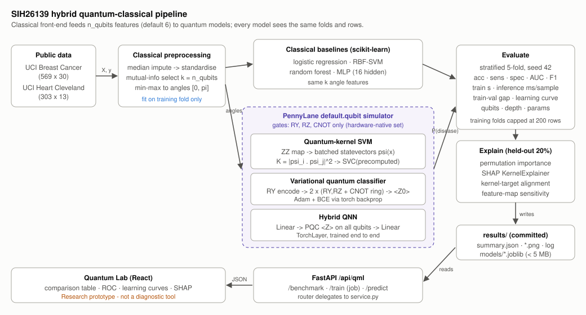

# MedFusion · SIH26139 Hybrid Quantum ML for Early Disease Detection

> **Research prototype - not a diagnostic tool.** Every model here is trained on public benchmark
> datasets and run on a quantum *simulator*. Outputs must not be used for any clinical decision.

This repository adds a hybrid quantum-classical machine-learning module (`backend/ml/quantum/`), a
FastAPI service (`/api/qml`) and a **Quantum Lab** page to the MedFusion React app. It benchmarks
three quantum / hybrid models against four classical baselines on two public disease-detection
datasets, with explainability and a full efficiency / generalisation report.

## Architecture



1. **Ingestion** - `data.py` loads UCI Breast Cancer Wisconsin (bundled with scikit-learn) and UCI
   Heart Disease (Cleveland, downloaded once into `backend/ml/quantum/data_cache/`). Positive class
   (1) = disease.
2. **Classical feature engineering** - `preprocess.py`: median imputation -> standardisation ->
   mutual-information selection of `k = n_qubits` features (PCA available) -> min-max scaling to
   rotation angles in `[0, pi]`. Fitted on the training fold only.
3. **Models** - classical baselines (`baselines.py`: logistic regression, RBF-SVM, random forest, MLP)
   and quantum models on PennyLane `default.qubit`:
   - `qkernel.py` - **quantum-kernel SVM**: ZZ-style feature map; the kernel
     `K_ij = |<psi(x_i)|psi(x_j)>|^2` is computed from batched statevectors (one broadcast circuit
     execution per data matrix, not one circuit per pair), then `SVC(kernel="precomputed")`.
   - `vqc.py` - **variational quantum classifier**: RY angle encoding + hardware-efficient ansatz
     (per layer RY, RZ on every qubit and a CNOT ring), readout `<Z0>`, trained with Adam + BCE.
   - `hybrid_qnn.py` - **hybrid QNN**: `Linear -> TorchLayer(PQC, <Z> on all qubits) -> Linear`.
4. **Evaluation** - `evaluate.py`: stratified 5-fold CV (seed 42), metrics below, timing, learning
   curves. **Explainability** - `explain.py`: permutation importance and SHAP for every model, plus
   kernel-target alignment and feature-map sensitivity for the quantum kernel.
5. **Serving** - `service.py` holds the logic; `router.py` only delegates. Results are JSON files
   under `backend/ml/quantum/results/`; an optional Supabase schema is in
   `backend/db/migrations/001_qml.sql` (not applied).

**Near-term hardware compatibility.** All circuits use only RX/RY/RZ/CNOT, are plain PennyLane
QNodes with 6 qubits and depth 17-25, and use no simulator-only operations; switching
`qml.device("default.qubit")` to a hardware or noisy-simulator device is the only change needed. The
statevector kernel shortcut is simulator-only; on hardware the same kernel would be estimated with
the standard compute-uncompute (adjoint) circuit and shots.

## Quick start

```bash
bash scripts/run_demo.sh
```

This one command installs Python and Node dependencies, runs the benchmark (about 7 minutes on a
laptop CPU), starts the API on `:8000` (Swagger at `/docs`) and the UI on `:3000`. Open
`http://localhost:3000/quantum-lab`. Set `SKIP_BENCHMARK=1` to reuse the committed results.

Step by step:

```bash
pip install torch==2.14.1 torchvision==0.29.1 --index-url https://download.pytorch.org/whl/cpu
pip install -r backend/requirements-qml.txt
python -m backend.ml.quantum.benchmark --dataset all --seed 42 --n-qubits 6
python -m uvicorn backend.main:app --port 8000
npm ci && npm run dev
```

Tests: `python -m pytest backend/tests -q --cov=backend/ml/quantum` and `npx vitest run`.

## API (`/api/qml`)

| Method | Path | Purpose |
|---|---|---|
| GET | `/health` | status, whether benchmark results exist |
| GET | `/datasets`, `/models` | catalog with sources and licences |
| GET | `/benchmark` | full results (metrics, ROC, learning curves, explanations) |
| POST | `/train` `{dataset, model, n_qubits}` | starts a background job (202), returns `job_id` |
| GET | `/jobs/{job_id}` | job status and held-out metrics |
| GET | `/models/{model_id}` | feature names and selected features of a saved model |
| POST | `/predict` `{model_id, features}` | P(disease) + per-feature SHAP explanation |

Inputs are validated with pydantic (422), unknown ids return 404, errors never include exception
text (500 responses carry only a request id), CORS origins come from `ALLOWED_ORIGINS`, and request
bodies are size-limited. Every response that carries a prediction includes the disclaimer.

## Metrics

Positive class = disease (malignant tumour / heart disease present).
`sensitivity = TP / (TP + FN)`, `specificity = TN / (TN + FP)`, plus accuracy, ROC AUC and F1, all
reported as mean ± std over stratified 5-fold CV with seed 42. **Efficiency** = mean training time
per fold and inference ms per sample on the same CPU. **Generalisation** = train accuracy minus
validation accuracy (gap) and a learning curve over five training-set sizes. Every training fold is
stratified-subsampled to at most 200 rows - the same rows for every model - so quantum training
stays tractable on a simulator and the comparison is fair.

## Results

All numbers below are generated from `backend/ml/quantum/results/summary.json` (benchmark log:
`results/benchmark.log`). Plots: `results/roc_*.png`, `results/learning_curve_*.png`,
`results/importance_*.png`.

<!-- RESULTS:START -->
Run `2026-10-08T17:01:32+00:00` at commit `9409691`, Python 3.13.3, 6 qubits, 5-fold CV, seed 42, 40 epochs, max 200 training rows per fold, total runtime 391.0 s.

### Breast Cancer Wisconsin (Diagnostic) (n = 569, positive = malignant)

| Model | Family | Accuracy | Sensitivity | Specificity | AUC | F1 | Train s/fold | Infer ms/sample | Gap | Qubits / depth |
|---|---|---|---|---|---|---|---|---|---|---|
| Logistic regression | classical | 0.926 ± 0.029 | 0.858 ± 0.100 | 0.966 ± 0.024 | 0.979 ± 0.025 | 0.894 ± 0.048 | 0.006 | 0.002 | 0.029 | - |
| SVM (RBF) | classical | 0.921 ± 0.030 | 0.873 ± 0.082 | 0.950 ± 0.032 | 0.978 ± 0.022 | 0.890 ± 0.045 | 0.004 | 0.007 | 0.036 | - |
| Random forest | classical | 0.921 ± 0.034 | 0.897 ± 0.088 | 0.936 ± 0.038 | 0.977 ± 0.022 | 0.893 ± 0.050 | 0.335 | 0.230 | 0.078 | - |
| MLP | classical | 0.926 ± 0.030 | 0.858 ± 0.099 | 0.966 ± 0.024 | 0.981 ± 0.021 | 0.894 ± 0.048 | 0.477 | 0.012 | 0.031 | - |
| Quantum-kernel SVM | quantum | 0.886 ± 0.031 | 0.863 ± 0.102 | 0.899 ± 0.054 | 0.955 ± 0.023 | 0.847 ± 0.045 | 0.035 | 0.187 | 0.098 | 6 / 25 |
| VQC | quantum | 0.923 ± 0.027 | 0.849 ± 0.109 | 0.966 ± 0.035 | 0.980 ± 0.021 | 0.888 ± 0.049 | 9.178 | 0.184 | 0.025 | 6 / 17 |
| Hybrid QNN | hybrid | 0.923 ± 0.022 | 0.863 ± 0.090 | 0.958 ± 0.040 | 0.980 ± 0.020 | 0.891 ± 0.037 | 10.460 | 0.196 | 0.041 | 6 / 17 |

QSVM kernel-target alignment (training rows): 0.215.

### Heart Disease (Cleveland) (n = 303, positive = heart disease present (num > 0))

| Model | Family | Accuracy | Sensitivity | Specificity | AUC | F1 | Train s/fold | Infer ms/sample | Gap | Qubits / depth |
|---|---|---|---|---|---|---|---|---|---|---|
| Logistic regression | classical | 0.815 ± 0.038 | 0.770 ± 0.080 | 0.854 ± 0.029 | 0.901 ± 0.024 | 0.791 ± 0.051 | 0.006 | 0.004 | 0.021 | - |
| SVM (RBF) | classical | 0.805 ± 0.044 | 0.748 ± 0.094 | 0.854 ± 0.029 | 0.902 ± 0.026 | 0.776 ± 0.056 | 0.007 | 0.014 | 0.041 | - |
| Random forest | classical | 0.841 ± 0.052 | 0.805 ± 0.078 | 0.872 ± 0.058 | 0.900 ± 0.040 | 0.822 ± 0.061 | 0.295 | 0.368 | 0.090 | - |
| MLP | classical | 0.818 ± 0.038 | 0.755 ± 0.073 | 0.872 ± 0.022 | 0.888 ± 0.032 | 0.791 ± 0.048 | 0.251 | 0.005 | 0.012 | - |
| Quantum-kernel SVM | quantum | 0.762 ± 0.040 | 0.727 ± 0.100 | 0.793 ± 0.103 | 0.836 ± 0.032 | 0.735 ± 0.051 | 0.034 | 0.469 | 0.115 | 6 / 25 |
| VQC | quantum | 0.667 ± 0.048 | 0.583 ± 0.087 | 0.739 ± 0.123 | 0.755 ± 0.048 | 0.614 ± 0.050 | 8.679 | 0.261 | 0.080 | 6 / 17 |
| Hybrid QNN | hybrid | 0.792 ± 0.061 | 0.762 ± 0.068 | 0.818 ± 0.078 | 0.861 ± 0.067 | 0.771 ± 0.063 | 10.533 | 0.305 | 0.075 | 6 / 17 |

QSVM kernel-target alignment (training rows): 0.118.

<!-- RESULTS:END -->

**Conclusion.** On breast cancer the VQC and the hybrid QNN *match* the classical baselines
(accuracy 0.923 vs 0.921-0.926, AUC 0.980 vs 0.977-0.981, all within one standard deviation),
while the quantum-kernel SVM *trails* (0.886 accuracy, 0.955 AUC). On heart disease every quantum
model *trails*: the best, the hybrid QNN, reaches 0.792 accuracy / 0.861 AUC against 0.815-0.841 /
0.888-0.902 for the classical models, and the VQC drops to 0.667 / 0.755. The quantum models also
cost roughly 10 s of training per fold versus under 0.5 s. Likely reasons: only 6 features reach
the circuit; a 2-layer, 6-qubit ansatz has limited expressivity; the ZZ kernel is close to diagonal
for these angle ranges (low kernel-target alignment, larger train-validation gap); and with at most
200 training rows the small linear models are already near the data's ceiling. **There is no
evidence of quantum advantage here**, which is the expected outcome for noiseless, shallow circuits
on small tabular data.

## Datasets and licences

| Dataset | Rows x features | Positive class | Source | Licence |
|---|---|---|---|---|
| Breast Cancer Wisconsin (Diagnostic) | 569 x 30 | malignant (212) | [UCI #17](https://archive.ics.uci.edu/dataset/17/breast+cancer+wisconsin+diagnostic), via scikit-learn | CC BY 4.0 |
| Heart Disease (Cleveland) | 303 x 13 | num > 0 | [UCI #45](https://archive.ics.uci.edu/dataset/45/heart+disease), `processed.cleveland.data` | CC BY 4.0 |

Both are de-identified public research datasets. No patient data is stored in this repository; the
heart file is cached locally and gitignored. Synthea / synthetic data is not used for any reported
number.

## Limitations

- **Simulator, not hardware.** Results are noiseless statevector simulations; real devices add
  shot noise and gate errors that would lower quantum performance.
- **Small circuits, small data.** 6 qubits, 2 layers, at most 200 training rows per fold. Results do
  not support any claim of quantum advantage.
- **Feature bottleneck.** One feature per qubit means 30 (or 13) inputs are reduced to 6 before the
  quantum model sees them; classical baselines are given the same 6 features for fairness.
- **ZZ kernel concentration.** With features spread over `[0, pi]` the ZZ kernel is close to diagonal,
  which explains the QSVM's larger train-validation gap; bandwidth tuning was deliberately not done
  to avoid tuning on validation data.
- **Cost.** Quantum models train in about 10 s per fold on a simulator versus milliseconds for
  logistic regression.
- The existing ECG / X-ray / CT endpoints have no trained weights in this repository and return
  HTTP 503; they are out of scope for SIH26139.

## Ethics

Research and education only. Not validated clinically, not a medical device, not a diagnostic
tool. Benchmark datasets are small and from specific populations (Wisconsin, Cleveland), so models
may not generalise and may encode population bias. Any clinical use would need prospective
validation, regulatory review and clinician oversight.

## Delivery Table

| # | Deliverable | Location | Status |
|---|---|---|---|
| 1 | Hybrid QML package (data, preprocessing, baselines, QSVM, VQC, hybrid QNN, explainability, evaluation, benchmark) | `backend/ml/quantum/` | Done |
| 2 | Benchmark results (JSON, markdown, ROC / learning-curve / importance plots, log, saved models) | `backend/ml/quantum/results/` | Done |
| 3 | REST API with background training jobs and explained predictions | `backend/ml/quantum/router.py`, `service.py`, `backend/main.py` | Done |
| 4 | Quantum Lab UI (pickers, training, comparison table, ROC, learning curves, importance, prediction) | `src/pages/QuantumLab.tsx` | Done |
| 5 | Tests: pytest (97% coverage of the QML package) and vitest | `backend/tests/`, `src/pages/__tests__/` | Done |
| 6 | CI workflow (type-check, vitest, build, pytest + coverage gate) | `.github/workflows/ci.yml` | Done |
| 7 | Architecture diagram, README, demo script | `docs/architecture.svg`, `README.md`, `docs/DEMO_SCRIPT.md` | Done |
| 8 | SIH idea deck | `docs/SIH26139_idea_deck.pptx` | Done |
| 9 | Optional Supabase schema with row-level security (not applied) | `backend/db/migrations/001_qml.sql` | Done |
| 10 | One-command demo | `scripts/run_demo.sh` | Done |
| 11 | Plan / issue list, decision log | `docs/ISSUES.md`, `DECISIONS.md` | Done |
